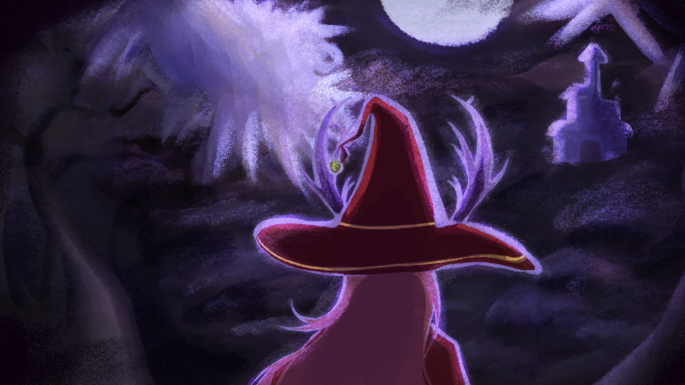

# RuneWeavers



**RuneWeavers** is a top-down dungeon-crawler where you cast spells by drawing rune patterns. Connect runes on the rune wheel to form red, yellow, or blue spells, read which enemy is the biggest threat, and hit it with the element it's weak to as you fight through the Witch's mansion.

It was built by team **RuneHolders** (8 people) for GAM200 at DigiPen Institute of Technology Singapore. We wrote our own C++20 engine, **EnoEngine**, with no commercial engine underneath. It comes with an ImGui level editor and C# gameplay scripting.

## Play & watch

| | |
|---|---|
| 🎮 **Play it** | Download `RuneWeavers_Setup.exe` from the [latest release](https://github.com/zonghan822/RuneHolders/releases/latest) (Windows 10/11, x64) |
| ▶️ **Gameplay video** | `RuneWeavers_Gameplay.mp4` on the [latest release](https://github.com/zonghan822/RuneHolders/releases/latest) |
| 🛠️ **My contributions walkthrough** | `PersonalContribution_CSD2451_RuneHolders_LawZongHan.mp4` on the [latest release](https://github.com/zonghan822/RuneHolders/releases/latest) |
| 🗺️ **Level editor showcase** | [`media/RuneHolders_LevelEditor_Showcase.mp4`](media/RuneHolders_LevelEditor_Showcase.mp4) |
| 📑 **Final presentation** | [`media/RuneHolders_Presentation_Final.pdf`](media/RuneHolders_Presentation_Final.pdf) |

---

## My role: Zong Han Law (Graphics & Input Champion)

Every source file has a header listing its authors and each author's share of the work. I'm the primary author of these systems:

| Area | What I built | Key files |
|---|---|---|
| **Engine core** | Main engine class and game loop that run every subsystem | [`eno_engine`](GameEngine/src/Engine/engine/) |
| **C# scripting host** | Hosts the .NET runtime through `hostfxr`/`nethost`, manages script lifetimes, and provides the C-export bridge between C++ and C# | [`eno_core_host`](GameEngine/src/Engine/eno_core_host/), [`scripting`](GameEngine/src/Engine/scripting/), [`bridge`](GameEngine/src/Engine/bridge/) |
| **AI & pathfinding** | A* pathfinding, path agents, and the AI manager | [`ai/`](GameEngine/src/Engine/ai/) |
| **State machines** | Runtime state machine system, plus a visual editor that generates C# script stubs | [`state_machine/`](GameEngine/src/Engine/state_machine/), [`stateMachine_editor/`](GameEngine/src/App/Editor/stateMachine_editor/) |
| **Tilemaps** | Layered tilemap system and the in-editor map painter | [`tilemap/`](GameEngine/src/Engine/tilemap/), [`map_editor/`](GameEngine/src/App/Editor/map_editor/) |
| **Graphics & text** | Renderer work and FreeType text rendering | [`graphics/`](GameEngine/src/Engine/graphics/) |
| **Platform** | GLFW window management, keyboard/mouse/gamepad input, config, file system, and resource loading | [`window/`](GameEngine/src/Engine/window/), [`input/`](GameEngine/src/Engine/input/), [`settings/`](GameEngine/src/Engine/settings/), [`resources/`](GameEngine/src/Engine/resources/) |
| **Editor** | Editor application layer and scene tree | [`App/Editor`](GameEngine/src/App/Editor/), [`editor/`](GameEngine/src/Engine/editor/) |

## Engine highlights

- **Archetype-based ECS** with an event bus and signals
- **Custom memory allocators**: arena, frame, buddy, TLSF, and slab
- **C# gameplay scripting** on an embedded .NET runtime, with hot reload
- **ImGui editor**: scene hierarchy, prefabs, undo/redo, tilemap painting, and a state-machine graph editor
- **2D physics and collision**, particles, sprite-sheet animation, UI canvas and buttons
- **FMOD** audio and **FFmpeg** video playback for cutscenes
- **Launcher** for choosing resolution and vsync before the game starts

**Tech:** C++20, OpenGL 4.5, GLFW, GLEW, GLM, Dear ImGui (docking), FreeType, stb_image, FMOD, FFmpeg, .NET 8, CMake

## Building (Windows)

Requirements: Visual Studio 2022 with *Desktop development with C++*, CMake 3.28+ (4.x tested), and Git. The .NET SDK is downloaded automatically if it isn't installed.

```bat
cd GameEngine
run.bat
```

`run.bat` configures the project, builds it, and launches the editor. `ship.bat` packages a Release build of the game and launcher into `GameEngine/RuneWeavers/`. The full build guide is in [`GameEngine/projectGuide.txt`](GameEngine/projectGuide.txt).

### Rebuilding the installer

The installer is made with [Inno Setup](https://jrsoftware.org/isinfo.php) from [`Installer/InstallScript.iss`](Installer/InstallScript.iss):

1. Run `GameEngine/ship.bat`, then copy the contents of `GameEngine/RuneWeavers/` into `Installer/GAMEDIRECTORY/` (next to the tracked `Icon.ico`).
2. Put `VC_redist.x64.exe` ([Microsoft download](https://aka.ms/vs/17/release/vc_redist.x64.exe)) in `Installer/REDIST/`.
3. Open `InstallScript.iss` in Inno Setup and compile. The output is `Installer/INSTALLER/RuneWeavers_Setup.exe`.

## Controls

| Action | Keyboard / Mouse | Xbox controller |
|---|---|---|
| Move | WASD | Left stick |
| Interact | E | A |
| Spellbook | F | Y |
| Draw runes / cast | Hold left click | Hold RT + left stick |

The full gameplay walkthrough and cheat codes are in [`GameEngine/RuneHolders_Readme.txt`](GameEngine/RuneHolders_Readme.txt).

## Repository layout

```
GameEngine/
├── src/Engine/      EnoEngine (static lib + shared bridge DLL)
├── src/App/         Editor, RuneWeavers (game), RuneLauncher
├── scripts/Core/    C# engine API (nodes, bridge bindings, hot reload)
├── scripts/RuneWeavers/user_scripts/   Gameplay scripts
├── assets/          Art, audio, video, shaders, scenes, prefabs
├── cmake/           Dependency fetching and build helpers
└── lib/             Prebuilt FMOD and FFmpeg
Installer/           Inno Setup script, EULA, and icon
media/               Level editor showcase and final presentation
```

## Team RuneHolders

| Name | Role |
|---|---|
| Qi Ming Jeremy Chia | Project Manager, Design Lead |
| Sabrina Jing Jie Loh | Art Lead, Audio Champion |
| Muhammad Raziq Bin Mohd Rafig | Technical Lead, Rendering Champion |
| **Zong Han Law** | Graphics Champion, Input Champion |
| Caven Koh | Physics Champion |
| Zhe An Lee | Engine Champion |
| Yun Ji Koe | Level Editor Champion |
| Kimberly Charlotte Madlangbayan Ambrosio | Collision Champion |

## Copyright

All content © 2025 DigiPen Institute of Technology Singapore, all rights reserved. This code is shared for portfolio purposes only.

Third-party libraries keep their own licenses: FMOD is used under the FMOD EULA, and this FFmpeg build under the GPLv3 (see `GameEngine/lib/ffmpeg/LICENSE.txt`).
